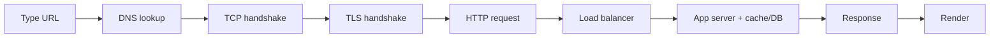

# 01 - What happens when you type a URL

Example: `https://google.com`

| # | Step | Protocol |
|---|------|----------|
| 1 | URL parsing / HSTS check | Browser (HSTS) |
| 2 | DNS cache lookup | DNS |
| 3 | DNS resolution | DNS over UDP 53 |
| 4 | Find gateway MAC address | ARP |
| 5 | TCP 3-way handshake | TCP (port 443) |
| 6 | TLS handshake | TLS 1.3 |
| 7 | HTTP request | HTTP/2 or HTTP/3 (QUIC) |
| 8 | Load balancer | L4 (TCP) / L7 (HTTP) |
| 9 | App server, cache and database | Redis protocol / SQL over TCP |
| 10 | Response and render | HTTP |

---

## 1. URL parsing / HSTS check - *Browser (HSTS)*

- The browser splits the URL into scheme (`https`), host (`google.com`) and path (`/`).
- **HSTS** (HTTP Strict Transport Security) list says "always use HTTPS for this site", so the browser never tries plain HTTP.

## 2. DNS cache lookup - *DNS*

- Computers talk using IP addresses (like `142.250.x.x`), not names.
- Before asking the internet, check nearby caches in order: **browser cache -> OS cache -> router**.
- If found, skip to step 4.

## 3. DNS resolution - *DNS over UDP port 53*

- If not cached, ask the **ISP's DNS resolver**, which walks the chain:
  **Root server -> `.com` TLD server -> Google's authoritative server**.
- The IP address is returned and **cached** (for its TTL) for next time.

## 4. Find the gateway's MAC address - *ARP*

- The target IP is outside your local network, so packets go to your **router (gateway)** first.
- **ARP** finds the router's physical (MAC) address on the local network.

## 5. TCP handshake - *TCP, port 443*

Sets up a reliable connection with a three-step "hello":

- **SYN** - Client: "Can we talk?"
- **SYN-ACK** - Server: "Yes, ready."
- **ACK** - Client: "Great, starting."

TCP ensures data arrives **complete and in order**.

## 6. TLS handshake - *TLS 1.3*

Makes it secure (the "S" in HTTPS):

- The server sends its **TLS (SSL) certificate**, proving it's really `google.com`.
- Browser and server agree on **encryption keys**.
- From then on, all data is encrypted, so nobody in between can read it.

## 7. HTTP request - *HTTP/2 or HTTP/3 over QUIC*

- The browser asks for the page, e.g. `GET / HTTP/1.1`.
- **Headers** carry extra info: cookies, browser type (`User-Agent`), accepted formats (`Accept`).

> HTTP/3 runs on **QUIC (UDP)**, which combines the TCP + TLS handshakes into one faster step.

## 8. Load balancer - *L4 (TCP) / L7 (HTTP)*

- Big sites have many servers.
- The **load balancer** sends your request to a **healthy, less-busy** server.
  - **L4** routes by IP/port; **L7** can route by URL path, headers or cookies.

## 9. App server, cache and database - *Redis protocol / SQL over TCP*

- The server runs the **application logic**.
- It checks the **cache** (like Redis) first; on a miss, it reads from the **database**.
- Then it builds the response.

## 10. Response and render - *HTTP*

**Response** - the server replies with a status code:

| Code | Meaning |
|------|---------|
| `200 OK` | Success |
| `301` | Moved / redirected |
| `404` | Not found |
| `500` | Server error |

It also carries **headers** and the **body**: HTML, CSS, JS and images.

**Render** - the browser draws the page:

1. HTML is parsed into the **DOM** (tree of elements).
2. CSS is parsed into the **CSSOM** (styles).
3. Both combine into the **Render tree**.
4. **Layout** - work out where each element goes.
5. **Paint** - draw pixels on screen.
6. **JavaScript** runs and can change the page dynamically (extra files are fetched over more HTTP requests).

---

## 3-minute narration cheat line

> URL parse -> DNS cache -> DNS resolve -> ARP -> TCP -> TLS -> HTTP request -> Load balancer -> Server + cache/DB -> Response + render

